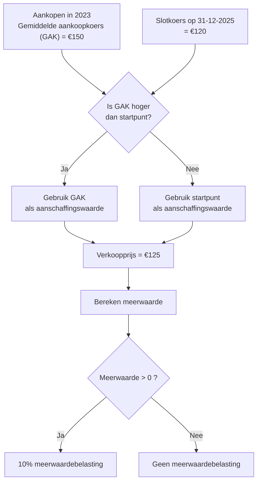

# Berekening meerwaardebelasting, Bolero example 1

> *Voorbeeld 1*
>
> *Je kocht in 2023 verschillende keren hetzelfde aandeel aan een gemiddelde aankoopkoers (GAK) van €150. De slotkoers op 31 december 2025 bedraagt €120. Je verkoopt later het volledige pakket aan €125. Omdat de GAK (€150) hoger ligt dan de waarde op het startpunt (€120), wordt de GAK gebruikt als aanschaffingswaarde. Er ontstaat geen meerwaarde aangezien de verkoopprijs (€125) lager ligt dan de GAK (€150). Daarom is geen meerwaardebelasting verschuldigd.*
>
> *Bron: https://www.bolero.be/nl/lp/meerwaardebelasting*

---

