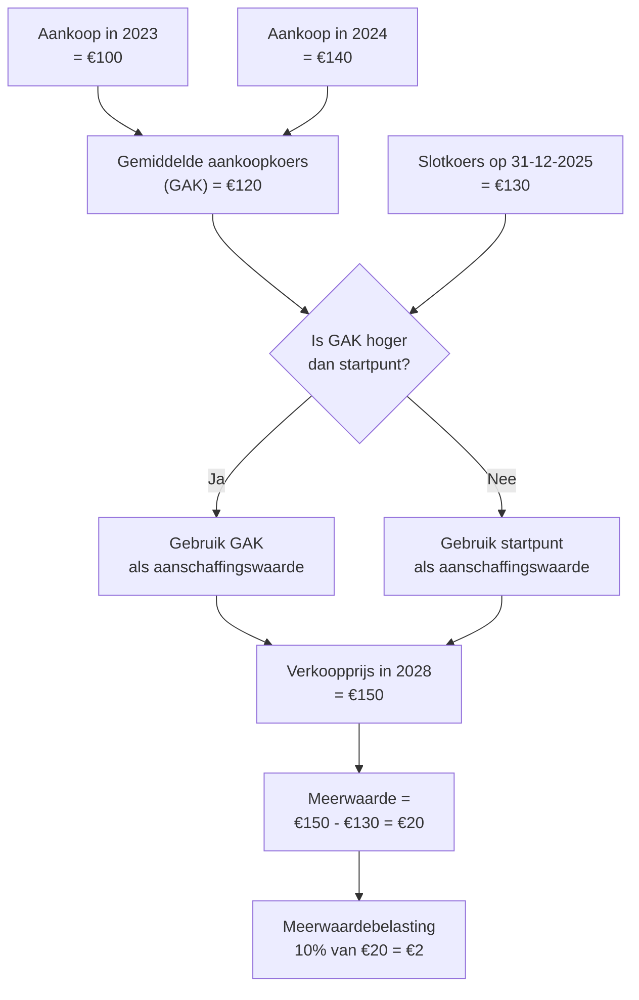

# Berekening meerwaardebelasting, Bolero example 2

<i>
Voorbeeld 2: aankoop vóór 31-12-2025, GAK is lager dan de slotkoers van 31-12-2025 en de verkoop gebeurt boven de GAK.
Je kocht een aandeel in verschillende stappen vóór 2026: in 2023 aan €100 en in 2024 aan €140, waardoor de gemiddelde aankoopprijs (GAK) €120 bedraagt.
De slotkoers op 31 december 2025 bedraagt €130 (het startpunt).
Je verkoopt het volledige pakket in 2028 aan €150.
Omdat de GAK (€120) lager ligt dan de waarde van het aandeel op het startpunt (€130), wordt het startpunt gebruikt als aanschaffingswaarde.
De belastbare meerwaarde bedraagt €20 (€150 - €130).
De meerwaardebelasting bedraagt €2 (10% van €20).
  
Bron: https://www.bolero.be/nl/lp/meerwaardebelasting
</i>

