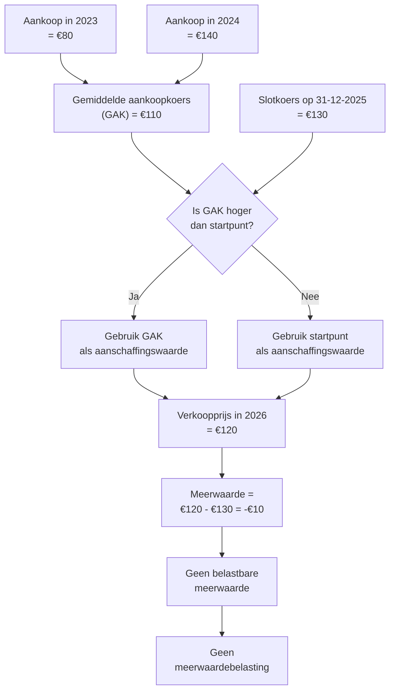

# Berekening meerwaardebelasting, Bolero example 3

<i>
Voorbeeld 3: aankoop vóór 31-12-2025, GAK is lager dan de slotkoers van 31-12-2025 en de verkoop gebeurt onder die slotkoers.
Je kocht een aandeel in verschillende stappen vóór 2026: in 2023 aan €80 en in 2024 aan €140. De gemiddelde aankoopprijs (GAK) bedraagt €110.
De slotkoers op 31-12-2025 bedraagt €130 (het startpunt).
Je verkoopt het volledige pakket in 2026 aan €120.
Omdat de GAK (€110) lager ligt dan de waarde van het aandeel op het startpunt (€130), wordt het startpunt als aanschaffingswaarde gebruikt.
Er ontstaat geen belastbare meerwaarde omdat de verkoopprijs (€120) lager ligt dan de referentiewaarde (€130).
Hoewel je effectief winst maakt ten opzichte van je GAK (€120 tegenover €110), wordt uitsluitend gekeken naar het verschil met het startpunt (€130).
Daarom is geen meerwaardebelasting verschuldigd.
  
Bron: https://www.bolero.be/nl/lp/meerwaardebelasting
</i>

