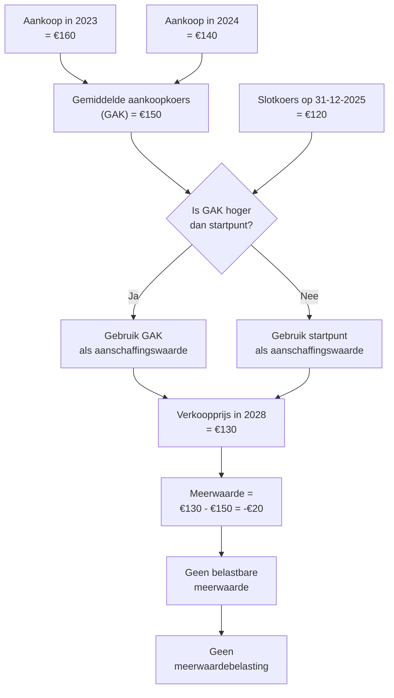

# Berekening meerwaardebelasting, Bolero example 4

<i>
Voorbeeld 4: aankoop vóór 31-12-2025, GAK is hoger dan de slotkoers van 31-12-2025 en de verkoop gebeurt boven die slotkoers.
Je kocht een aandeel in verschillende stappen vóór 2026: in 2023 aan €160 en in 2024 aan €140. De gemiddelde aankoopprijs (GAK) bedraagt €150.
De slotkoers op 31-12-2025 bedraagt €120 (het startpunt).
Je verkoopt het volledige pakket in 2028 aan €130.
Omdat de GAK (€150) hoger ligt dan de waarde van het aandeel op het startpunt (€120), wordt het startpunt genegeerd en wordt de GAK als aanschaffingswaarde gebruikt.
Er ontstaat geen belastbare meerwaarde omdat de verkoopprijs (€130) lager ligt dan de GAK (€150).
Hoewel de verkoopprijs hoger ligt dan het startpunt (€120), wordt voor de berekening de gunstigste aanschaffingswaarde gebruikt, namelijk de hogere GAK van €150.
Daarom is geen meerwaardebelasting verschuldigd.
  
Bron: https://www.bolero.be/nl/lp/meerwaardebelasting
</i>

